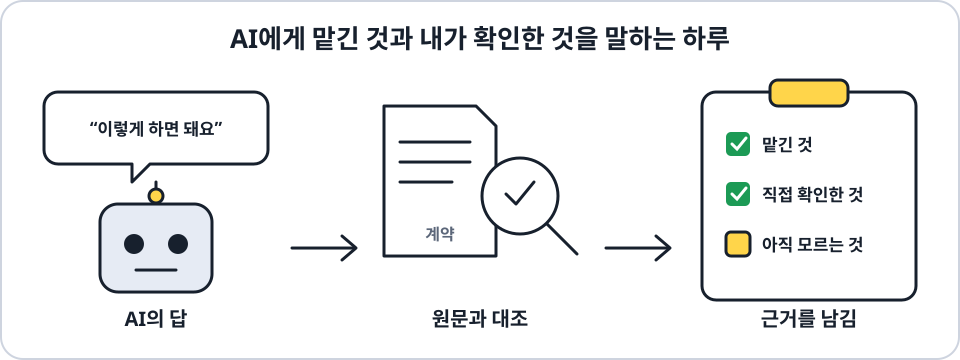
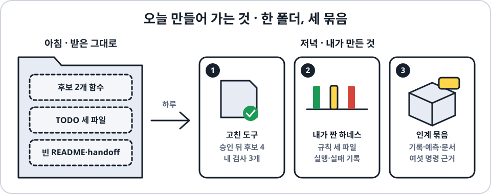
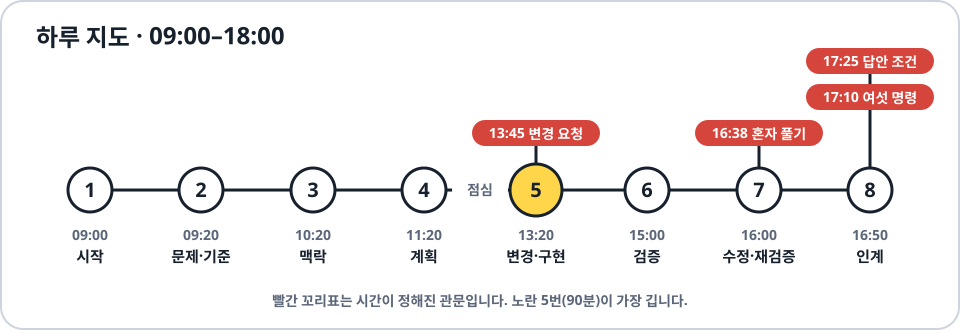
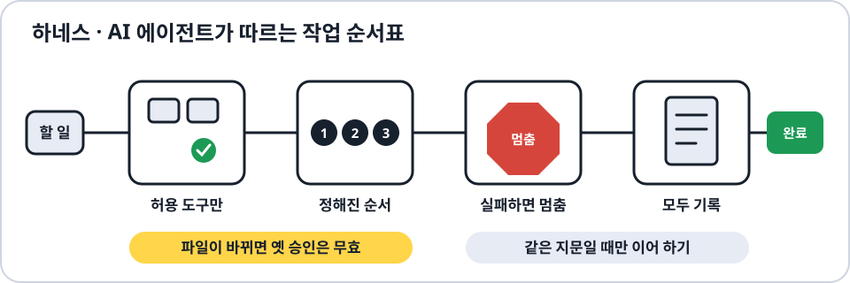

# GitHub Copilot 중급과정

**Agentic SDLC with Github Copilot** · 2026년 10월 28일(수) 09:00–18:00 · 1인 1프로젝트 실습



> **AI가 써 준 답을 그냥 믿지 않고, 무엇을 맡겼고 무엇을 직접 확인했는지 설명할 수 있게 되는 하루입니다.**
> 앱을 새로 만들지 않습니다. 이미 동작하는 작은 JavaScript/Node.js 코드(가상의 **테스트 결과 정리 도구**)에서 요구가 바뀌고 결함이 생기는 상황을 직접 겪습니다.

**[바로 시작](#바로-시작)** · **[그림 따라하기](./따라하기.html)** · **[오늘 만들어 가는 것](#오늘-만들어-가는-것)** · **[하루 지도](#하루-지도)** · **[교육 목표와 내용](#교육-목표와-확인할-작업물)** · **[사전 준비](#수강-대상과-사전-준비)** · **[단계별 시작 안내](./PARTICIPANT-START.txt)** · **[개인 기록장](./workbook.html)**

## 바로 시작

준비물은 VS Code, Node.js 22 이상, 사용 권한이 있는 Copilot 계정입니다.

```bash
git clone https://github.com/ijhan-biz/lgvs-copilot-intermediate-workshop.git
cd lgvs-copilot-intermediate-workshop/example-project
npm run preflight
npm test
```

`npm test`가 16개 통과하면 출발 준비가 된 것입니다. 수업 중에는 브라우저로 **[그림 따라하기](./따라하기.html)** 페이지를 열어 한 장씩 따라 합니다. `npm run …`은 언제나 `example-project` 안에서 칩니다. 기록장 `workbook.html`은 브라우저로 엽니다.

결과를 그림으로 보고 싶으면 같은 폴더에서 `npm run web`을 치고 브라우저로 `http://127.0.0.1:4173`을 엽니다. 입력에서 후보까지의 흐름, 지금 코드의 후보 정책, 내 진행 상태를 보여 주는 읽기 전용 화면이고, `src/`를 고친 뒤 새로고침하면 바로 다시 계산합니다.

## 오늘 만들어 가는 것



하루 동안 `example-project` 한 폴더를 **아침에 받은 그대로**에서 **저녁의 내 결과물**로 바꿉니다. 만드는 것은 세 묶음입니다.

1. **승인된 만큼만 고친 도구.** 실패 2개만 후보로 고르던 함수를, 13:45 요청과 사람 승인 뒤 한 곳만 고쳐 후보 4개로 넓힙니다. 그 변경을 지키는 내 검사 3개와, 결함 있는 검토 사본을 고친 것도 남습니다.
2. **내가 짠 하네스.** AI 에이전트가 따를 작업 규칙 세 파일을 직접 쓰고, 일부러 실패시켜 안전장치가 동작하는지 확인한 기록을 남깁니다.
3. **남이 이어받을 인계 묶음.** 기록 여섯 칸, 혼자 쓴 예측과 첫 결과, 인계 문서, 마지막에 여섯 명령을 다시 실행한 근거입니다.

아래 [교육 목표](#교육-목표와-확인할-작업물) 네 가지는 이 세 묶음을 만들면서 익힙니다. 기록 여섯 칸(목적·기대값·변경 이유·실행 결과·미확인·다음 행동)은 워크북이나 `work-record.json` 한 곳에 하루 내내 이어 씁니다.

<details>
<summary>파일로 보면 · 아침에 받은 것과 저녁에 남는 것</summary>

모두 `example-project` 안의 경로입니다.

| 파일 | 아침 | 저녁 |
| --- | --- | --- |
| `.baseline/` | 없음 | 어떤 파일이든 고치기 전에 남긴 기준 사본 |
| `test/learner.test.mjs` | 제공 검사 1개 | 내 검사 3개 추가: 중복 → 후보 확대(먼저 실패) → 원본 보존 |
| `src/summarize-results.mjs` | 후보 `['failed']` | 승인 뒤 그 한 곳만 바꾼 후보 범위 |
| `review/summarize-results.mjs` | 없음(15:40에 결함 사본을 한 번 만듦) | 첫 실패를 남긴 뒤 원인을 찾아 고친 한 파일 |
| `harness/instructions.txt`, `harness/workflow.json`, `harness/run.mjs` | TODO | 내가 쓴 지시·설정·실행 순서와 실패 중단 분기 |
| `.harness/` | 없음 | 실행·시간 초과·금지 거절·stale·새 승인·이어 하기의 실제 기록 |
| `test/transfer.test.mjs` | `expectedIds = null` | 실행 전에 혼자 쓰고 고정한 예측 |
| `README.txt`, `handoff.txt` | 빈 안내 틀 | 실제 결과·변경 이유·제한과 근거 위치를 적은 인계 |
| `evidence/` | 없음 | 마지막에 다시 실행한 근거 |

</details>

## 하루 지도



강의 여덟 개를 차례로 지나며 세 묶음을 채웁니다. 시간이 정해진 관문은 넷입니다.

- **13:45 변경 요청.** 요청은 승인이 아닙니다. 사람 승인을 따로 기록한 뒤에만 후보 범위를 바꿉니다.
- **16:38–16:45 혼자 풀기.** AI·힌트·강사 도움 없이 새 입력의 후보를 예측하고, 실행 전에 고정합니다.
- **17:10–17:25 여섯 명령.** 대화 기억이 아니라 남긴 안내만 보고 본인이 다시 실행합니다.
- **17:25 답안 공개 조건.** 16:45 이후, 첫 예측과 첫 실제 결과를 고정하고 여섯 명령까지 마친 사람만 참고답안과 비교합니다.

자세한 시간표와 단계별 목표는 [하루의 학습 흐름](#하루의-학습-흐름)에 있습니다.

## 하네스는 이런 것



하네스는 AI 에이전트가 일할 때 따르는 안전한 작업 순서표입니다. 보호된 부품은 제공하고, 약 10–25줄의 조합과 실패 중단 분기는 직접 씁니다. 명령과 운영 순서는 [하네스 구축과 운영](#하네스-구축과-운영)에 있습니다.

---

여기까지가 전체 그림입니다. 아래는 자세한 규칙과 기준이라, 처음에는 필요한 시간에 해당 부분만 찾아 읽어도 됩니다. 교육 내용과 실습 자료는 이 저장소를 기준으로 관리하며, 별도 실습 ZIP·PDF·Word 대신 Markdown 안내, 실습 코드와 작성형 워크북을 사용합니다.

## 교육 목표와 확인할 작업물

**최소 하네스 구축·운영도 본과정 필수입니다.** 제공 실행기를 실행하는 데서 끝내지 않습니다. `harness/workflow.json`, `harness/run.mjs`, `harness/instructions.txt`를 직접 작성해 검증 → 승인 확인 → 순서 실행 → 기록 → 실패 중단/마무리를 연결합니다. 업무 함수는 후보만 만들고 하네스는 이 교육 도구의 허용 검사를 실행합니다.

| 교육 목표 | 수업에서 하는 일 | 확인할 작업물 |
| --- | --- | --- |
| **원하는 결과와 수정 범위를 설명하기** | 요구 문서와 입력을 보고 기대한 건수·후보를 먼저 계산합니다. AI에게 필요한 자료만 주고, 바꿀 부분과 유지할 조건을 정합니다. | 기대값과 그 이유, 선택한 자료, 수정·검증 계획, 편집 전 기준 사본 |
| **승인된 작은 변경을 직접 검증하기** | 새 요구를 확인하는 검사가 수정 전 코드에서 실패하는지 봅니다. 승인한 범위만 고치고, 별도 검토용 코드의 결함도 재현·수정합니다. | 수정 전후 차이, 본인 테스트, 실제 실행 결과, 실패 원인과 검증 한계 |
| **하네스를 직접 만들고 안전하게 운영하기** | 목적·맥락·허용 도구·출력·시간/재시도 상한과 실행 조합·중단 분기를 작성합니다. 실제 timeout·금지 요청·stale 거절·동일 fingerprint 재개를 확인합니다. | 세 학습자 파일, 실패/거절·새 검토/새 실행·checkpoint/재시도 상한·성공 단계 중복 방지의 실제 근거 |
| **새 입력을 판단하고 재현·인계하기** | 새 결과 자료의 후보를 먼저 예상합니다. 최초 예측과 실행 결과를 보존하고, 자기 안내서로 다시 실행합니다. | 새 입력의 예측·이유와 첫 결과, 실행 안내, 재현 기록, 미완료·미확인·받은 도움 |

이 표는 교육 목표를 실제 행동과 작업물로 풀어 쓴 것입니다. 기존 활동 시간을 교체하며 별도 시간·점수를 더하지 않습니다. 코드 검사 통과만으로 사람의 이해, Copilot 활용 숙련이나 실제 서비스 운영 능력을 인증하지 않습니다.

### 하네스 구축과 운영

보호된 실행 부품은 제공하지만 약 10–25줄의 조합과 실패 중단 분기는 본인이 만듭니다. 시작본 TODO 때문에 `harness:check`는 실패가 예상됩니다. 기존 업무 v1 `npm test` 16개 통과를 하네스 완성으로 쓰지 않습니다. 완성 구성이나 강사 실행기를 복사하지 않습니다.

`example-project`에서 실행할 명령입니다. 승인 이유는 현재 파일과 허용 범위를 검토한 뒤 자기 말로 씁니다.

```text
npm run harness:check
npm run harness:approve -- --reason "직접 검토한 범위와 이유"
npm run harness:run
npm run harness:drill -- timeout
npm run harness:drill -- forbidden
npm run harness:status
npm run harness:resume -- --latest
```

- **시간 초과·금지 요청:** 15:30–15:40 운영 10분 안에 C6 개인 검사 편집을 포함한 현재 파일을 사람이 직접 재검토하고 `npm run harness:approve -- --reason "직접 검토한 현재 파일의 범위와 이유"` → `npm run harness:run` → `npm run harness:status`로 갱신한 뒤 훈련합니다. 13:45 업무 승인과 별개인 로컬 재검토입니다. 실제 자식 프로세스 timeout 실패를 보존하고 금지 도구가 프로세스 실행·보호 쓰기 전에 거절되는지 확인합니다. 차단 훈련의 nonzero 종료는 예상 상태입니다.
- **오래된 근거:** 성공 후 허용된 `instructions.txt`를 수정합니다. stale 상태·재개 거절을 확인한 뒤 사람이 현재 파일을 재검토·승인해 **새 실행**을 남깁니다.
- **안전한 재개:** 같은 fingerprint의 중단 작업만 checkpoint에서 이어 갑니다. 재시도 상한·성공 단계 재사용·완료 작업 재개 시 중복 효과 부재를 실제로 확인합니다. fingerprint가 바뀌면 강제 재개하지 않습니다.

기존 활동 시간을 **교체**합니다. 요구사항 정제 기존 활동 25분=5/7/10/3, 맥락 30분=지침/자료 10·주장 대조 15·상태 기록 5, 계획 40분=입력/도구 15·순서/중단/복구 15·인수/기록 10입니다. 계획·검증 단계은 아침 baseline 뒤 선택한 주 기록 한 곳(워크북 또는 `work-record.json.coreRecord`)에 기록할 수 있지만 런타임·코드·테스트·설정 구현이나 실행은 하지 않습니다. 구축/변경 70분=승인 10·구축 25·업무 정책 15·실행 15·기록 5, 결과 검증 검증 30분=업무 보존 10·차단 훈련 10·review 준비와 첫 실패 10(10/10/10), 수정·재검증 복구 30분=review 복구 10·하네스 stale/재개 8·독립 과제 7·회귀 5, 자가 검증·인계 인계 35분=구축/운영 인계 10·기존 여섯 명령 15·근거 해석/조건부 비교·잠정 자가평가 10입니다.

09:00–18:00의 교육 440분에 활동 265분(오프닝 5분 포함)이 들어 있습니다. 휴식 40분·점심 60분은 그대로입니다. **HVE는 요구사항 정제 필수 통합 활동**입니다. 09:20–09:30 framing 10분 + 09:30–09:40 JS 브리지 10분 + 09:40–10:05 기존 실습 25분 + 10:05–10:10 debrief 5분으로 운영합니다. HVE 40분은 framing 10 + 기존 실습 25 + debrief 5이며 JS 10분은 HVE 밖이지만 요구사항 정제 안입니다. 별도 강좌·추가 시간·새 양식이 아닙니다. 모든 JSON·지침·기록의 **첫 편집 전 기준선**, 13:45 요청과 실제 승인 구분, 16:38–16:45 도움 금지, **16:45 이후 AND 최초 예측·테스트 동결 AND 최초 실제 결과 동결**의 도움 공개 조건, 17:10–17:25 기존 여섯 명령, 17:25 이후 조건부 답안 공개를 유지합니다. 일찍 끝내도 16:45 전에는 도움을 열지 않으며, 차단·미실행은 HOLD·unknown·exit null로 남기고 절차 지원만 받습니다.

13:25–13:40 workflow 작성은 이미 사람이 검토한 하네스 범위만 구축합니다. 업무 정책 변경은 **13:45 요청 공개와 실제 사람 승인 모두**가 있어야 하며 시각만으로 허용되지 않습니다. 실행 전 현재 파일의 로컬 하네스 재검토·승인 선언은 업무 승인과 별개입니다. 결과 검증의 `prepare:review`는 15:40에 정확히 한 번만 실행하고, 그 전에는 review 부재/기존 여부만 확인하며 미리 준비하지 않습니다. 기존 review가 있으면 덮어쓰기·삭제·재준비 없이 상태를 남깁니다.

자가 검증·인계 첫 개인 활동 10분(17:00–17:10)은 README/handoff 4 + 저장·동결 1 + 비판 2 + 현재 파일 새 검토·로컬 승인·실행 2 + status 1분입니다. README/handoff 변경 뒤 갱신한 하네스 근거를 **17:10 전** 남깁니다. 17:25–17:35 기존 10분 활동에서 조건부 비교·기록·잠정 자가평가를 하고, 17:35–17:50은 강사 설명(핵심 의미·영향 해설 8 + 강사 Q&A 7분)이며 추가 학생 활동이 아닙니다.

실제 명령·exit·fingerprint·산출물 상대 경로를 **기존 여섯 칸 한 곳**에 연결합니다. 업무 공통 16개·개인 최소 4개·review 16개·독립 1개와 하네스 결과를 합산하지 않습니다. 구축·필수 운영 근거가 없으면 전체 완료는 HOLD입니다. 5항목 각 0–2점·합계 8점 이상·필수 3항목 각각 1점 이상은 유지합니다. 워크북의 `harness-built`, `harness-operated`는 수동 확인이며 자동 실행 검증이 아닙니다. 옛 JSON의 누락 체크는 미확인으로 남습니다.

허용 목록은 완전한 샌드박스가 아닙니다. 보호 런타임·공통 검사·데이터·package.json은 고치지 않으며 임의 셸·네트워크·추가 설치는 없습니다. 로컬 승인 선언은 신원 인증·실제 기업 승인이 아닙니다. Copilot은 조직 승인 도구로 수동 사용하며 모델 API를 자동 호출하지 않습니다. 사람의 완료 시간은 미측정이고 기술 통과는 학습·현장 운영 인증이 아닙니다.

## 실습 예제: 테스트 결과 정리

빌드는 검사할 프로그램의 한 버전이고, 모듈은 기능별 묶음입니다. 결과 파일을 읽어 한 빌드의 상태별 건수, 모듈별 요약과 **검토·재실행 후보**를 만듭니다. 후보를 정할 뿐 검사를 자동 실행하거나 출시를 승인하지 않습니다.

| 입력의 상태 | 의미 | 공개 예제의 검사 수 |
| --- | --- | --- |
| `passed` | 통과로 기록됨 | 2 |
| `failed` | 실패로 기록됨 | 2 |
| `timed_out` | 제한 시간 안에 끝나지 않음 | 1 |
| `not_run` | 실행하지 않음 | 1 |

공개 입력은 8행입니다. 선택한 빌드의 7행에서 동일한 중복 1행을 제외하면 검사 6개입니다. 다른 빌드의 1행은 합산하지 않습니다.

검사는 `buildId`, `module`, `caseId`를 함께 보고 구분합니다. 세 값과 이름·상태까지 같은 반복은 한 번만 세고, 같은 검사인데 이름이나 상태가 다르면 충돌로 알립니다. **미실행은 통과가 아닙니다.** 입력 파일의 상태별 건수와 이 도구를 확인하는 `node:test`의 통과 수는 서로 다른 값입니다.

### 요구·계획·개발의 토대: DDD와 BDD

[도메인·행동 학습 안내](./example-project/domain-behavior.txt)를 계약·공개 입력과 함께 먼저 읽습니다.

- **DDD(Domain-Driven Design, 도메인 주도 설계):** 빌드·모듈·검사 전체 키, 중복과 충돌, 후보의 뜻과 업무 경계를 정합니다. 이 요약 문맥은 실제 재실행·CI·출시 결정과 다릅니다. 새 Entity나 마이크로서비스를 만드는 과제가 아닙니다.
- **BDD(Behavior-Driven Development, 행동 주도 개발):** 업무·개발·QA 관점의 발견 질문 → 구체적 Given/When/Then 합의 → 독립 기대 단언 → 승인된 최소 변경 → 기존 `node:test`와 증거로 연결합니다. 문장 형식만 채우는 것이 아니며 Cucumber 설치는 필요 없습니다. 혼자 관점을 점검하고 가상 참석자와 회의했다고 기록하지 않습니다.

요구에서는 용어·규칙·예시를 정하고, 계획에서는 **규칙 → 합의 예시 → 허용 파일·보존 계약 → 실제 검사 제목·명령 → 예상 관찰 → 증거 경로**를 연결합니다. 개발에서는 승인 후 RED/GREEN을 직접 관찰합니다. 안내의 정상·반복·충돌·빈 결과·입력 보존 예시는 공개 자료만 사용하며, 기존 16개 계약 검사와 연결됩니다.

기존 주 기록 여섯 칸에 이어 쓰고 README 완성란·handoff는 그 위치를 참조합니다. 별도 양식·추가 검사 수·점수는 없습니다. INVEST는 스토리, SOLID는 코드 책임·계약, SMART는 과업 완료의 명확성을 보조하며 DDD/BDD를 대신하지 않습니다. 독립 전이의 무지원 구간과 예측·첫 결과 두 동결은 유지합니다.

### 수업 중 바뀌는 요구

처음에는 실패한 검사 2개만 후보로 뽑습니다. **13:45에 변경 요청을 공개하고 사람이 승인한 뒤**, 시간 초과와 미실행을 포함한 후보 4개로 넓힙니다.

후보 범위만 바뀝니다. 상태별 건수, 중복·충돌 처리, 순서, 입력 검사와 원본 보존은 유지합니다. 구현 계약과 입력은 [contract.txt](./example-project/contract.txt), [test-results.json](./example-project/data/test-results.json)에서 확인합니다.

## 하루의 학습 흐름

### 먼저 읽는 순서

처음이라면 **아래 연결도와 일곱 단계 설명 → [참가자 시작 안내](./PARTICIPANT-START.txt) → [업무 용어와 행동 예시](./example-project/domain-behavior.txt)·[계약](./example-project/contract.txt)·[공개 입력](./example-project/data/test-results.json) → 현재 단계의 [실행 안내](./example-project/README.txt)** 순서로 읽습니다. `workbook.html`은 같은 작업의 기록장입니다. 모든 참고 자료를 처음부터 외우거나 새 문서를 만들 필요는 없습니다.

합성 요청인 “테스트 결과를 정리하고 재실행까지 해 주세요”를 그대로 구현하면, 후보 보고와 실제 실행 권한을 섞기 쉽습니다. 먼저 **선택 빌드에서 무엇을 다음에 살펴볼지 돕는 도구**로 범위를 좁힙니다. 실제 고객 요구를 조사한 결과가 아니라 학습용 가정입니다.

```text
합성 요청·계약·공개 8행
  → ① 같은 검사·반복·처음 후보의 뜻과 기대값
  → ② AI에게 줄 근거 선택·답과 원문 대조
  → ③ 허용 파일·유지할 동작·확인 방법을 잇는 계획
  → 13:45 요청 공개 + 별도 사람 승인
  → ④ 후보 확대의 실패 확인 → 최소 변경 → 재검사
  → ⑤ 보존 동작 확인·별도 검토 사본의 첫 실패
  → ⑥ 원인 재현·승인 범위 복구 + 별도 무지원 독립 시도
  → ⑦ 자기 안내서로 재현·근거와 미확인을 연결한 인계
```

뜻이 다르면 용어와 예시로, 출처가 충돌하면 현재 계약으로, 실제 결과가 다르면 실패 재현으로 돌아갑니다. AI 요약이나 설명을 고쳐도 새 실행 근거가 생기지는 않습니다.

| 시작·단계 | 왜 필요한가 / 목표 | 지금 하는 일 | 남는 결과 → 다음 단계의 입력 |
| --- | --- | --- | --- |
| 09:20 문제와 성공 기준 | “자동 정리”만으로는 같은 검사를 어떻게 셀지 알 수 없습니다. | 필수 HVE framing 10분·JS 브리지 10분·기존 실습 25분·debrief 5분으로 진행합니다. 계약과 8행에서 선택한 7행·고유 6개·중복 1행과 처음 실패 후보 2개를 직접 계산합니다. 첫 편집 전 기준선을 남기고 반복 규칙을 검사합니다. | 목적·독립 기대값·첫 실행 근거 → AI에게 전달할 기준 |
| 10:20 맥락과 모델 선택 | 계약은 원하는 동작, 코드는 구현, 출력은 특정 실행의 관찰입니다. | 필요한 파일 부분만 고르고 AI 답의 주장을 원문과 대조합니다. 허용 모델과 접근 한계도 구분합니다. | 선택·채택·기각 이유와 미확인 → 계획의 전제 |
| 11:20 계획과 검증 기준 | 바꿀 부분만 정하면 유지할 동작을 놓칠 수 있습니다. | 규칙·합의 예시·허용 파일·보존 동작·검사 제목과 명령을 연결합니다. 아침 baseline 뒤 선택한 워크북 또는 coreRecord JSON 한 곳에 계획을 기록하되 런타임·테스트·설정 구현이나 실행은 하지 않습니다. | 변경·검증·중단 계획 → 오후 요청과 비교할 기준 |
| 13:20 요구 변경과 구현 | 미래 예시나 AI 제안은 현재 정책의 승인이 아닙니다. | 먼저 시작 정책을 확인합니다. 13:45 공개와 사람 승인 후에만 시간 초과·미실행을 포함한 후보 4개를 기대하고, 변경 전 실패를 본 뒤 후보 조건만 고칩니다. | 승인 범위·실패/통과·작은 변경 → 보존 동작 검증 대상 |
| 15:00 결과와 기준 검증 | 후보가 맞아도 원본을 바꾸거나 다른 규칙을 깨뜨릴 수 있습니다. | 입력·새 배열·첫 원본 참조를 확인하고 별도 검토 사본의 첫 실패를 보존합니다. | 기대와 실제 차이·원인 가설 → 복구할 근거 |
| 16:00 수정과 재검증 | 여러 실패 메시지가 여러 원인이라는 뜻은 아닙니다. | 최소 반례로 원인을 좁혀 승인 범위만 복구·재검사합니다. 16:38–16:45에는 별도 새 입력에서 예측과 최초 결과를 도움 없이 동결합니다. | 복구 근거·회귀 결과·독립 시도와 도움 상태 → 인계 자료 |
| 16:50 자가 검증과 결과 정리 | 대화 기억이 아니라 남긴 안내만으로 확인할 수 있어야 합니다. | 안내를 보존·비판한 뒤 17:10–17:25 본인이 여섯 명령을 재현합니다. 17:25 이후에도 공개 조건을 갖춘 뒤에만 참고답안과 비교합니다. | 실제 마지막 상태·한계·다음 행동 → 이어받는 사람의 판단 근거 |

위 결과는 기존 주 기록의 **목적·기대값·변경 이유·실행 결과·미확인·다음 행동**에 이어 씁니다. 단계마다 새 양식이나 검사를 더하지 않습니다. 공개 입력의 상태는 계속 통과 2·실패 2·시간 초과 1·미실행 1이며, 승인 후 바뀌는 것은 후보 범위뿐입니다. 후보는 실제 재실행이나 출시 허가가 아닙니다.

2026년 10월 28일(수) **09:00–18:00 운영 계획**입니다. 수업·실습 440분 안에 개인 활동 265분이 포함됩니다. 휴식 40분과 점심 60분은 별도입니다.

| 시간 | 단계 | 핵심 활동 |
| --- | --- | --- |
| 09:00–09:20 | 시작·환경 확인 | 작업 폴더와 실행 환경 확인 |
| 09:20–10:10 | 문제와 성공 기준 | 필수 HVE framing 09:20–09:30, JS 브리지 09:30–09:40, 기존 실습 09:40–10:05, debrief 10:05–10:10 |
| 10:20–11:10 | 맥락과 모델 선택 | 필요한 파일 선택, AI 답과 원자료 대조 |
| 11:20–12:20 | 계획과 검증 기준 | 수정 범위·확인 방법·승인 조건 정리. 아직 구현하지 않음 |
| 13:20–14:50 | 요구 변경과 구현 | 13:25–13:40 이미 검토한 하네스 범위 workflow 구축만; 업무 변경은 13:45 요청 공개 AND 실제 사람 승인 뒤 RED·최소 변경·재검사 |
| 15:00–15:50 | 결과와 기준 검증 | 활동 10/10/10: 상태·중복·원본 보존, 하네스 차단 훈련, 15:40 prepare:review 한 번과 첫 실패 |
| 16:00–16:50 | 수정과 재검증 | 원인 재현·최소 수정, 16:38–16:45 새 입력 독립 시도 |
| 16:50–17:50 | 자가 검증과 결과 정리 | 17:10 전 갱신 하네스 근거, 17:10–17:25 여섯 명령, 17:25–17:35 조건부 비교·잠정 자가평가, 17:35–17:50 강사 설명 |
| 17:50–18:00 | 마무리 | 남은 문제와 업무에 적용할 방법 정리 |

단계별 명령과 기록 방법은 [참가자 시작 안내](./PARTICIPANT-START.txt)와 [실습 README](./example-project/README.txt)를 따릅니다.

## 수강 대상과 사전 준비

Copilot 자동완성이나 Chat을 써 본 개발자·QA·코드 실습이 가능한 팀 리드를 대상으로 합니다. 짧은 함수·배열·조건문을 읽고 파일을 편집·저장·실행할 수 있어야 합니다. JavaScript 문법을 짧게 연결해 설명하지만, 프로그래밍 입문 과정은 아닙니다.

준비할 것은 개인 PC, 조직이 허용한 **VS Code**, **Node.js 22 이상과 npm**, 사용 권한이 있는 **Copilot 계정**입니다. Git은 선택사항입니다. 추가 npm 패키지, 관리자 권한, 클라우드나 별도 AI 실행 도구는 필요하지 않습니다.

Copilot 로그인, Chat 응답, 조직 네트워크와 허용 모델은 직접 확인합니다. **실습 코드의 로컬 실행에 네트워크가 필요 없다는 말은 Copilot도 오프라인으로 동작한다는 뜻이 아닙니다.** 정책상 사용이 막히면 운영자에게 알리고, 수동 대조와 실제 AI 사용을 구분해 기록합니다.

AI Credit은 계획상 1인당 1,000 준비를 권장합니다. 실측 사용량·소비 상한·필수 추가 구매량은 아닙니다. 교육 당일 사용할 조직 제공량과 잔여 예산을 운영자에게 확인하고, 부족해 보여도 먼저 구매하지 말고 문의합니다.

## 시작 방법

### 자료 받기

Git을 사용한다면 저장소를 복제합니다.

```bash
git clone https://github.com/ijhan-biz/lgvs-copilot-intermediate-workshop.git
cd lgvs-copilot-intermediate-workshop/example-project
```

`npm run …` 명령은 모두 `example-project` 폴더 안에서 칩니다. 저장소 맨 위 폴더에서 치면 `cd example-project`로 이동하라는 안내만 나오고 아무것도 실행하지 않습니다(종료 1).

Git을 사용하지 않는다면 GitHub의 **Code → Download ZIP**을 누르고 완전히 압축 해제합니다. 이 파일은 GitHub가 저장소에서 자동으로 만든 소스 사본입니다. 별도로 관리하는 배포 ZIP이 아닙니다. 압축 파일 안에서 바로 편집·실행하지 않습니다.

어느 방법이든 같은 파일을 받습니다. `workbook.html`은 로컬 브라우저로 열고, **`example-project` 폴더만** VS Code에서 엽니다. GitHub 소스 ZIP을 받았다면 압축을 푼 상위 폴더 이름에 `-main`이 붙을 수 있습니다. 터미널이 그 안의 `example-project`를 가리키는지 확인합니다.

### 사전 연습과 수업용 사본 분리

사전 연습은 별도 사본에서 합니다. `readiness/task.txt`를 읽고 `npm run readiness:check`의 의도적인 첫 실패를 확인한 뒤 직접 편집·저장·재실행합니다. 사전 연습의 수정 파일과 기록은 수업용에 옮기지 않습니다.

실제 수업용은 저장소를 새 폴더에 다시 복제하거나, GitHub에서 받은 새 소스 ZIP을 다른 폴더에 풉니다. 기존 작업을 삭제·초기화해서 새 원본처럼 만들지 않습니다.

### 공통 시작 절차

아래 명령은 손대지 않은 수업용 사본의 `example-project`에서 실행합니다.
명령별 무엇·왜·입력·예상 출력·산출물·다음 행동은 [도메인·행동 안내 5절](./example-project/domain-behavior.txt)에서 확인합니다. `preflight`는 Node 버전과 수동 점검 질문을 출력하며 폴더·필수 파일·Copilot 권한을 자동 검증하지 않습니다.

```bash
node --version
npm run preflight
npm test
```

처음 `npm test`는 제공 검사 16개가 모두 통과해야 합니다. `npm install`은 하지 않습니다. **어떤 파일이든 처음 고치기 전**, 수업에서 다음 명령으로 비교할 원본을 남깁니다.

```bash
npm run baseline
```

이미 기준 사본이 있다면 지우거나 덮어쓰지 않습니다. 실행이 안 되면 위치·Node 버전·오류부터 확인하고 도움을 요청합니다.

### 개인 기록 파일 준비

복제와 GitHub 소스 ZIP 모두 빈 `work-record.template.json`을 제공합니다. 프로젝트 JSON을 주 기록으로 선택했다면 **환경·시작 검사와 첫 편집 전 기준 사본 보존을 마친 뒤**, 파일 탐색기나 편집기로 이를 같은 폴더의 `work-record.json`으로 복사합니다. 워크북을 주 기록으로 선택했다면 이 복사와 이중 입력은 필요하지 않습니다.

Git으로 복제한 경우 실제 개인 기록은 `.gitignore`로 추적에서 제외됩니다. GitHub 소스 ZIP에는 `.git` 이력이 없으며, 이 무시 규칙은 웹에서 파일을 수동 업로드하는 것을 막아주지 않습니다. 빈 템플릿은 고치지 말고, `git add -f`나 수동 업로드로 개인 기록을 공개하지 않습니다. 이미 추적되는 README·인계 파일에도 개인정보나 비밀을 적지 않습니다.

## 처음 보이는 실패를 구분하기

| 명령 | 처음 상태의 의미 |
| --- | --- |
| `npm test` / `npm run test:v1` | 처음 후보 정책의 제공 검사 16개 통과 |
| `npm run test:v2` | 아직 새 정책을 구현하지 않았으므로 후보 범위 검사 1개 실패 예상 |
| `npm run test:learner` | 제공 예제 1개 통과. 본인이 추가한 검사가 아님 |
| `npm run readiness:check` | 사전 편집 연습의 빈 값 때문에 첫 실패 예상. 별도 연습 사본에서만 수정 |
| `npm run test:transfer` | 본인 예측을 아직 쓰지 않았으므로 미작성 실패 예상. 지정된 독립 시도 시간에 작성 |
| `npm run test:review` | 검토용 사본을 준비하기 전에는 실행 불가. 결과 검증 15:40에 정확히 한 번 `npm run prepare:review`로 준비; 그 전에는 부재/기존 여부 확인만 |

예상한 검사의 실패와 문법·경로 오류는 다릅니다. 통과를 얻으려고 기대값이나 검사를 삭제하지 않습니다.

승인된 새 정책을 구현한 뒤에는 `npm test` / `npm run test:v1`의 이전 후보 정책 검사 하나가 실패하는 것이 정상입니다. 최종 확인은 `npm run test:v2`로 하며, 이전 검사를 맞추려고 구현을 되돌리지 않습니다.

## 수업에서 집중할 다섯 가지

1. **검사의 역할과 한계:** 기존 검사 하나가 어떤 실수를 잡고, 기대값이 어디에서 나왔으며, 무엇을 확인하지 않았는지 설명합니다.
2. **조건을 남기는 요약:** 빌드 범위·중복 정책·미실행 구분·승인·미확인을 빠뜨리지 않습니다. 요약을 오늘 저장했다고 옛 실행 결과가 최신이 되지는 않습니다.
3. **새 근거가 있을 때 재시도:** 같은 실패 두 번 또는 새 근거 없는 10분이면 멈춥니다. 새 대화나 강한 표현은 새 증거가 아니며, 시도 이력·남은 시간·승인 범위도 초기화하지 않습니다.
4. **거절한 제안의 이유:** 어떤 현재 조건을 어겼고 언제 다시 검토할 수 있는지 적습니다. 특정 상황에서 틀린 방법을 영구 금지 규칙으로 바꾸지 않습니다.
5. **필요한 기록만 공유:** 합성 자료·별칭·명령·종료 상태·필요한 최소 출력만 사용합니다. 고객 자료, 개인정보, 비밀키, 비공개 대화 전문과 계정 화면은 제출하거나 공개 저장소에 올리지 않습니다.

## 완료와 기록의 기준

주 기록은 워크북 또는 `work-record.json` 중 하나를 골라 이어 씁니다. **목적·기대값·변경 이유·실행 결과·미확인·다음 행동**의 여섯 칸을 쓰며, 같은 내용을 두 곳에 다시 입력하지 않습니다.

HVE의 여섯 기록 범주는 기존 `coreRecord`에 연결합니다: 입력·목적/범위 → `purpose`, 성공 기준·독립 기대값 → `expected`, 종합·변경 판단 이유 → `changeReason`, 관찰·실행 근거 → `execution`, 가정·미확인 → `unknown`, 인계·다음 행동 → `nextAction`. 워크북은 기존 여섯 칸과 106개 입력을 그대로 사용하며 새 필드를 만들지 않습니다. 실제 최종 상태·시각·근거는 선택한 `work-record.json.coreRecord` 또는 워크북 여섯 칸 한 곳에서, 불변 `firstTransfer`와 수집기 파일 해시범위 **밖**에 누적합니다. 존재하지 않는 최종 전용 필드를 가정하거나 동결 기록·해시 대상 파일을 덮어쓰지 않습니다. 선택한 기록이 해시 대상이면 범위 밖의 기존 주 기록 위치를 먼저 확인하고, 없으면 HOLD로 남깁니다.

개인 검사 최소 4개는 **제공 1개와 본인이 추가한 3개**입니다. 공통 검사 16개, 별도 검토용 검사 16개, 새 입력 독립 과제 1개는 각각 구분합니다. 한쪽의 통과로 다른 미실행이나 실패를 대신하지 않습니다.

구현과 복구를 마친 뒤에는 본인 실행 안내만 보고 아래 여섯 명령을 하나씩 재현합니다.

```bash
npm run preflight
npm run test:v2
npm run test:learner
npm run test:review
npm run demo
npm run evidence
```

`evidence`는 최종 정책의 공통 검사 실행 근거입니다. 개인 검사·검토용 검사·사람 승인·AI 활용이나 교육 이수를 한꺼번에 증명하지 않습니다. 예상한 값, 실제 출력, 확인하지 못한 범위와 받은 도움을 함께 남깁니다.

실제로 확인했는데 기준에 못 미치는 수행과, 아직 근거를 확인하지 못한 상태는 다릅니다. **미실행·미확인은 점수를 짐작하지 않고 판단을 보류**합니다. 기존 평가는 다섯 항목 각 0–2점, 총점 8점 이상과 필수 세 항목의 최소점 조건을 유지합니다. 구체적인 기준은 워크북을 따릅니다.

## 독립 시도와 답안 공개

공개 예제에는 계산된 기대값이 있습니다. 따라 확인하는 학습용이지 정답을 모르는 상태의 능력 시험이 아닙니다.

새 입력 과제에서는 자기 예측·이유·검사 기대값을 먼저 저장·동결하고, 첫 실제 결과·출력·종료 상태도 저장·동결합니다. 도움은 **16:45 이후 AND 최초 예측·테스트 동결 AND 최초 실제 결과 동결**일 때만 엽니다. 일찍 완료해도 16:45 전에는 AI·힌트·강사 도움을 열지 않습니다. 차단·미실행이면 HOLD·unknown·exit null이며 결과를 꾸미거나 도움으로 대체하지 않습니다. 조건 미충족 시 절차·환경 지원만 허용하고 계약 손계산·기대 ID·JS 카드 등 내용 힌트는 대기 중에도 금지합니다. 첫 실패를 나중 통과에 맞춰 덮어쓰지 않고, 도움 뒤의 결과와 구분합니다.

강사 답안은 이 두 기록과 본인의 여섯 명령 재현·도움 내역을 확인한 뒤 **17:25부터** 별도로 제공합니다. 공개 저장소에는 강사 정답과 완성 비교 구현을 넣지 않았습니다. 수업 후 선택 실습도 별도 자료이며 필수 과제나 추가 점수가 아닙니다.

새 입력의 자동 검사는 **본인이 작성한 후보 ID 배열과 본인 코드의 출력이 일치하는지** 확인합니다. 둘 다 잘못되어도 통과할 수 있으므로, 통과만으로 예측의 정확성을 보증하지 않습니다. 17:25 이후 공개 조건을 갖추면 강사 참고답안과 이유를 따로 대조합니다. 그 한 번의 통과가 집계·충돌·원본 보존 전체나 독립 숙련을 인증하는 것도 아닙니다.

## 자료 구성

| 파일·폴더 | 용도 |
| --- | --- |
| `README.md` | 교육 목표·내용·초점·준비와 시작 방법 |
| `PARTICIPANT-START.txt` | 수업의 진행 순서와 공개 조건 |
| `따라하기.html` | 수업 중 한 단계씩 따라 하는 그림 안내. 칠 명령과 나오면 되는 신호를 장마다 보여 줌 |
| `workbook.html` | 브라우저로 작성하고 JSON으로 저장·불러오는 개인 기록장 |
| [HVE 원칙으로 요구사항 정제](./HVE-Core-Discovery-Framing-요구사항-정제.html) | 요구사항 정제 필수 HVE 40분의 원칙·방법 참고 자료; 기존 실습 25분 포함, 별도 강좌 아님 |
| `example-project/` | 작동하는 시작 코드, 합성 입력, 계약과 검사 |
| `example-project/work-record.template.json` | 기준 사본 보존 뒤 복사해 사용하는 빈 작업 기록 양식 |
| `example-project/.github/` | Copilot이 읽는 공통 지침·단계별 프롬프트·읽기 전용 검토 에이전트. 선택 도구이며 판단과 실행은 본인이 함 |
| `example-project/web/`, `example-project/scripts/web.mjs` | `npm run web`으로 여는 읽기 전용 결과 화면. 파일을 고치거나 검사·하네스를 실행하지 않음 |
| `readme-images/` | 이 README 맨 앞의 그림 네 장 |
| `package.json`, `root-hint.cjs` (맨 위) | 맨 위 폴더에서 `npm run`을 쳤을 때 `example-project`로 이동하라고 알려 주는 안내용. 실습 명령을 실행하지 않음 |

워크북 입력은 자동 저장되지 않습니다. 내보낸 실제 파일을 확인하고 보관합니다. GitHub의 HTML 파일 화면은 실행되는 워크북이 아니므로 내려받아 로컬 브라우저에서 엽니다.

HVE는 프레임워크 설치 없이 원칙·방법을 적용하는 **요구사항 정제 필수 통합 과정**입니다. 같은 합성 QA 사례의 입력→범위→관찰→종합→기존 여섯 칸→인계를 첫 활동에 연결합니다. 09:20–09:30 framing, 09:40–10:05 기존 코드·검사 실습, 10:05–10:10 debrief가 HVE 40분입니다. 09:30–09:40 JS 브리지는 별도 10분으로 같은 요구사항 정제 50분 안에 있습니다. 별도 40분 강좌·새 양식·추가 활동은 없으며, 가상 관찰은 실제 조사 근거가 아니고 초안은 고객 승인이나 구현 허가가 아닙니다.

## 검증 범위와 한계

기술 리허설은 별도 사본에서 시작 상태, 승인 전후의 검사, 결함 재현·복구, 새 입력 시도와 마지막 재현 명령을 확인하는 용도입니다. 미작성·실패·실행 불가를 완료로 바꾸지 않는지도 함께 봅니다.

공개 자료의 별도 사본에 작성자가 미리 정한 변경·기대값을 적용하는 방식으로 다음 세 흐름을 확인했습니다. 수강생이나 Copilot이 실제로 문제를 해결한 결과는 아닙니다.

| 가정한 작업 흐름 | 확인한 내용 | 기술 리허설 결과 |
| --- | --- | --- |
| 개발자형·저장소 복제 | 편집 전 기준 사본, 후보 변경 전 실패, 작은 수정, 결함 복구와 최종 여섯 명령 | 계획한 단계와 실제 결과 일치 |
| QA형·기존 배포본 시작 | 모듈별 같은 검사 번호, 중복·충돌·잘못된 입력, 미실행 구분과 재현 | 계획한 단계와 실제 결과 일치 |
| 지원 필요형·기존 배포본 시작 | 잘못된 작업 위치, 사전 연습, 미작성 예측과 검토 사본 누락 | 미완료로 남고 완료·정답 공개 판단을 보류 |

이 세 흐름의 결과는 앞선 배포본을 대상으로 한 기록입니다. 현재처럼 저장소 복제와 GitHub 소스 ZIP을 같은 절차로 사용하는 시작 경로는 별도로 확인합니다.

코드 실행 시간은 사람이 읽고 배우는 시간이 아닙니다. 역할을 가정한 시나리오도 실제 수강생 조사·학습 효과가 아니며, 실제 Copilot 추론·조직 권한·수업 지원 인력·교실 소요시간은 별도로 확인해야 합니다. 기본 과정을 끝냈다고 실제 제품 검사나 출시 준비가 끝났다고 판단하지 않습니다.

이 자료는 공식 LG 또는 Microsoft 발행·인증·후원을 뜻하지 않습니다. 별도의 재사용 라이선스는 지정하지 않았습니다.
